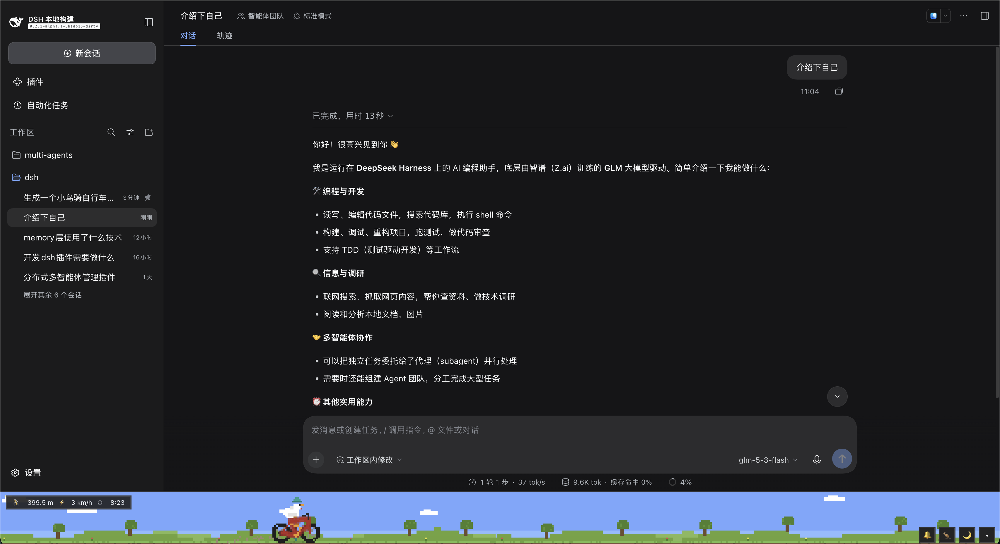
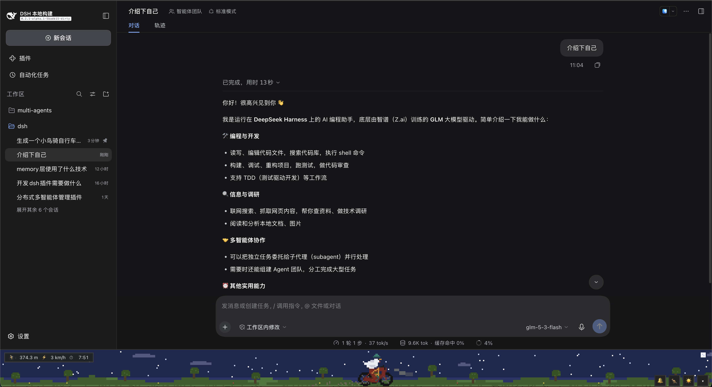

# dsh-bird-bike 🐦🚲

[](https://www.npmjs.com/package/dsh-bird-bike)

像素小鸡骑自行车 —— DeepSeek Harness(DSH)Web GUI 底部的我的世界像素风骑行带。
A helmeted pixel chicken rides a bicycle along a Minecraft-style pixel strip docked at the bottom of the DSH (DeepSeek Harness) web GUI.





## 特性 / Features

- 🐦 **像素小鸡骑士**:IK 反向动力学蹬腿、2 帧扑翅、会眨眼、戴蓝绿头盔
- 🚲 **像素自行车**:辐条车轮、链条牙盘、踏板曲柄
- 🌙 **昼夜循环**:约 80 秒一天,黄昏/黎明按 8 级色阶切换;夜晚有星星、方形月亮和车头灯光锥
- 🔔 **按铃**:芯片音叮铃 + MC 风彩色像素音符粒子 + 短暂加速冲刺(扬尘)
- 🦘 **跳跃**:方块感小跳,落地扬尘
- ⏱ **骑行统计**:里程 / 车速 / 骑行时长(仅实际骑行时累计),固定宽度等宽数字槽,不抖动
- ▾ **可收起**:整条骑行带收成 40px 迷你车道,状态本地持久化
- ♿ 尊重 `prefers-reduced-motion`:静止场景,交互仍可用

A helmeted pixel chicken with IK-pedaled legs, a day/night cycle (stars, square moon, headlight), chip-tune bell with note particles, jumps, and a fixed-width ride-stats chip. Collapsible to a mini rail; honors `prefers-reduced-motion`.

## 安装 / Install

### 方式一:官方 CLI(推荐)

```sh
# npm 包 / from npm
dsh plugin --profile web add dsh-bird-bike

# 或直接从 GitHub 安装 / or straight from GitHub
dsh plugin --profile web add git+https://github.com/blackstar-baba/dsh-bird-bike.git
```

纯 JavaScript、零构建、无 prepare 脚本 —— 安装时不会触发 pnpm 的 allowBuilds 构建授权。
Plain JavaScript with no build step and no prepare script, so the install never triggers a pnpm allowBuilds prompt.

### 方式二:DSH 插件管理器

1. 打开 DSH Web GUI → 侧边栏 **Plugins**
2. **Add plugin** → 箭头 → **Install a third-party plugin**
3. 粘贴仓库地址:`https://github.com/blackstar-baba/dsh-bird-bike` 并确认安装
4. 装完即生效 —— 看屏幕底部 🐦🚲

1. Open the DSH web GUI → **Plugins** in the sidebar
2. **Add plugin** → **Install a third-party plugin**
3. Paste the repository URL and confirm — the strip appears at the bottom of the app frame

### 方式三:手动 link 本地克隆

```bash
git clone https://github.com/blackstar-baba/dsh-bird-bike.git
cd ~/.dsh/profiles/<your-profile>          # 例如 web
pnpm add link:/absolute/path/to/dsh-bird-bike
```

然后在 GUI 的 **Plugins** 页面启用 `dsh-bird-bike`(或把 `"dsh-bird-bike"` 加入 profile `package.json` 的 `dsh.profile.bundles`)。

## 操作 / Controls

| 操作 / Action | 效果 / Effect |
| --- | --- |
| 点击骑行带 / click the strip | 按铃加速 + 音符 / bell + note particles + boost |
| 🔔 | 按铃 / ring the bell |
| 🦘 | 跳跃 / jump |
| 🌙 / ☀️ | 切换昼夜 / jump to the other phase |
| ▾ / ▴ | 收起 / 展开骑行带 / collapse / expand the strip |

## 实现说明 / How it works

- 纯 JavaScript、零依赖、零构建:一个 `client.js` 通过 `window.__ModuleLoader__` 注册懒工厂,挂进 ui-layout 的 `shell.bottom` 槽位
- 整个场景画在低分辨率离屏画布上(1 艺术像素 = P 个 CSS 像素),用硬像素原语(矩形 / Bresenham 线 / 扫描线椭圆)绘制,再最近邻放大
- 界面 chrome 使用 `--dsw-*` 主题 token;画面配色为作品自定调色板(artwork exception)
- Plain-JS client bundle, no build step. The scene renders on a low-res offscreen canvas with hard-edged pixel primitives and is upscaled nearest-neighbor. Chrome colors use `--dsw-*` theme tokens; artwork uses its own palette by design.

## 卸载 / Uninstall

GUI 的 **Plugins** 页面移除;或手动 `pnpm remove dsh-bird-bike`(在 profile 目录)并从 `dsh.profile.bundles` 移除。
Remove it from the **Plugins** page, or `pnpm remove dsh-bird-bike` inside the profile directory and drop it from `dsh.profile.bundles`.

## 兼容性 / Compatibility

在 DSH 源码检出(source checkout)的 `web` profile 上开发测试(`dsh.client` platform: web,manifest 声明 `dsh.bundle`)。无 npm 依赖,仅依赖 Client 基线内置模块(react、slots)。
Developed and tested on a DSH source checkout, `web` profile. No npm dependencies — only Client baseline builtins (react, slots).

## License

[MIT](LICENSE)
